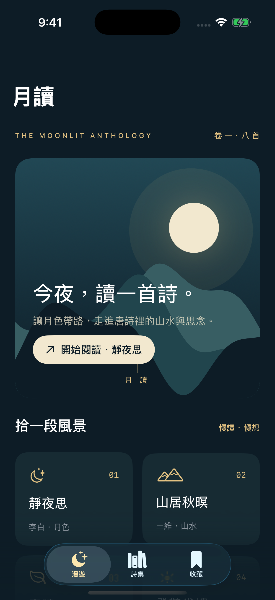
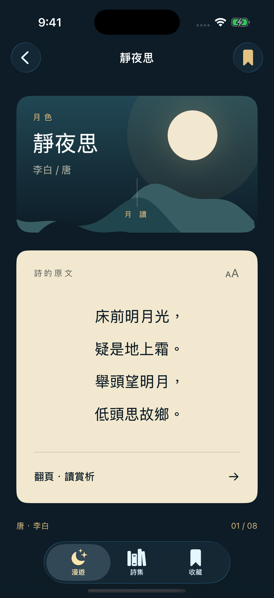
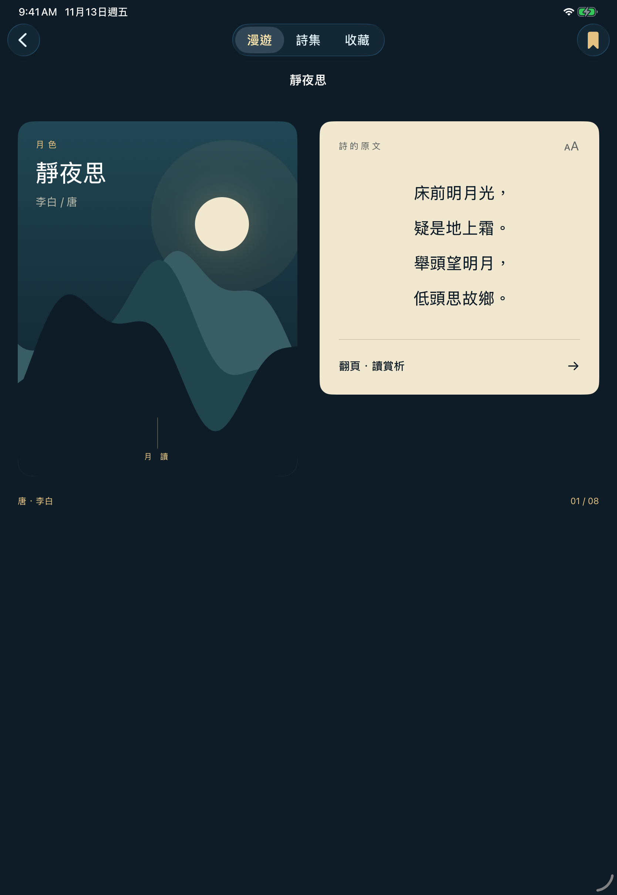

# 月讀・唐詩漫遊 🌙

SwiftUI #88：結合動畫效果的電子書 App。以深青色山水、月光與紙張質感，閱讀八首唐詩。

## 執行

使用 Xcode 26 開啟 `iosHw5.xcodeproj`，選擇 `iosHw5` scheme 與 iPhone 或 iPad 模擬器，按 **⌘R**。最低支援 iOS 18，無需 API key、外部套件或網路。

## 功能

- **漫遊**：月光呼吸與山巒位移動畫、精選閱讀入口。
- **詩集**：List 目錄、詩名／作者／詩句搜尋、主題篩選。
- **閱讀**：原文逐行浮現、原文／賞析翻頁過場、字體大小切換。
- **收藏**：書籤彈跳效果、UserDefaults 儲存，重啟後保留。
- **iPad**：寬版雙欄閱讀；窄視窗自動採直向排列。
- 支援系統減少動態效果；插畫以 SwiftUI Shape 繪製。

## 題目對照

| 要求 | 實作 |
| --- | --- |
| 多頁面、獨立檔案 | DiscoverView、LibraryView、PoemDetailView |
| NavigationStack、NavigationLink、傳資料、標題 | NavigationLink(value: poem) → navigationDestination(for: Poem.self)，閱讀頁顯示詩名 |
| array、struct、Identifiable | Poem.library: [Poem]；struct Poem: Identifiable, Hashable |
| List 搭配 Identifiable | LibraryView 的 List / ForEach(poems) |
| TabView & Tab | ContentView 的漫遊、詩集、收藏三分頁 |
| 動畫 | 月光、山巒、詩句進場、翻頁過場、收藏 symbolEffect |
| iPhone & iPad 畫面 | 下列截圖與 Submission/Medium 示範影片 |

## 展示

### iPhone

### iPad

## 繳交素材

- [作業說明](Submission/作業說明.md)
- [Medium 文章草稿](Submission/Medium/Medium文章草稿.md)
- [發布步驟](Submission/Medium/發布步驟.md)
- [iPhone 示範影片](Submission/Medium/Moonlit-iPhone-demo.mp4)
- [iPad 示範影片](Submission/Medium/Moonlit-iPad-demo.mp4)

古典詩作屬公版文字；賞析為本專案撰寫。山水與 App Icon 由程式繪製，未使用第三方圖片。
