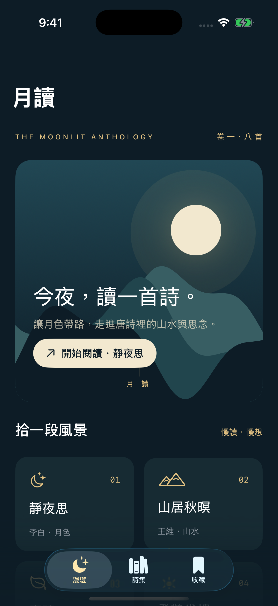
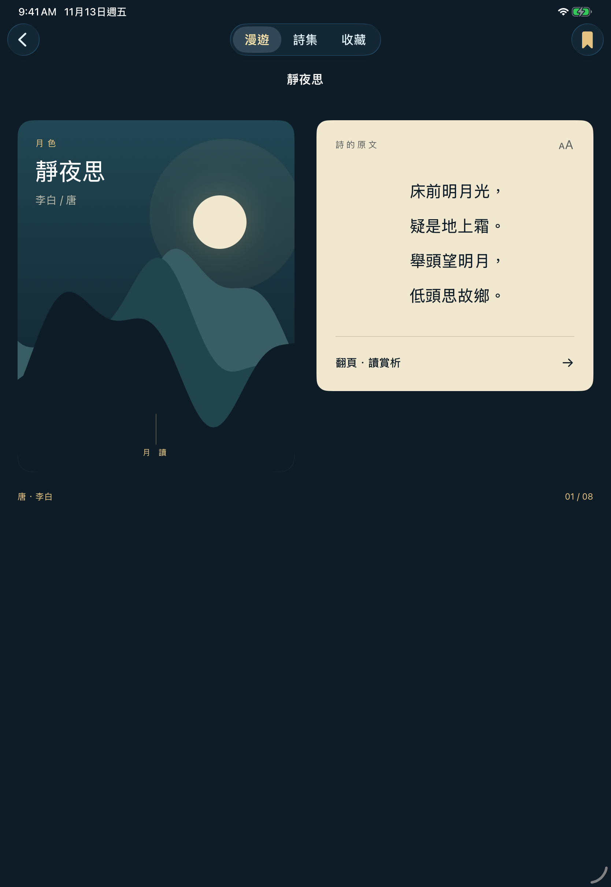

# #88 用 SwiftUI 做一本會呼吸的詩集：月讀・唐詩漫遊

> 發布前請依自己的實際理解與製作經驗修改文字，並加入影片連結。

這次的作品是「月讀・唐詩漫遊」。我希望電子書不只是把文字放上螢幕，而是讓讀者在閱讀之前，先進入詩的氣氛。App 以深青色、米白紙張與月光金為主色，收錄八首唐詩，每首都有原文與簡短賞析。

GitHub：https://github.com/Heisenbuwga/iosHw5

## 從首頁走進一首詩

首頁有一幅以 SwiftUI Shape 畫出的山水。月光緩慢呼吸，山巒也有輕微位移；點選「開始閱讀」就會進入《靜夜思》。下方的精選卡片則提供其他作品的閱讀入口。



## 把詩整理成資料

每首詩使用 `Poem` struct 表示，遵從 `Identifiable` 與 `Hashable`。`id` 提供穩定的識別值，標題、作者、主題、詩句與賞析都存在同一筆資料中。八首詩放在 `Poem.library` array，首頁與目錄共用這份資料。

```swift
struct Poem: Identifiable, Hashable {
    let id: Int
    let title: String
    let author: String
    let theme: String
    let lines: [String]
    let note: String
    let symbol: String
}
```

## NavigationStack 與資料傳遞

首頁和目錄都以 `NavigationStack` 管理導覽，`NavigationLink(value: poem)` 傳出使用者選擇的詩，再由 `navigationDestination` 建立閱讀頁。閱讀頁透過 `let poem: Poem` 接收資料，navigation bar 使用詩名作為標題。

```swift
NavigationLink(value: poem) {
    Text(poem.title)
}
.navigationDestination(for: Poem.self) { poem in
    PoemDetailView(poem: poem, store: store)
}
```

實際專案將 destination modifier 放在 NavigationStack 裡的內容容器上，讓所有詩作入口共用同一個目的頁。

## List 與三個分頁

詩集目錄使用 `List` 和 `ForEach(poems)`。因為 `Poem` 遵從 `Identifiable`，SwiftUI 可以辨識每一列。目錄可以依月色、山水、四季、思念篩選，也可以搜尋詩名、作者與詩句。

最外層使用 `TabView` 與 iOS 18 的 `Tab`，分成「漫遊」、「詩集」與「收藏」。收藏資料透過 `ReadingStore` 共用，並寫入 UserDefaults，因此重新開啟 App 仍能保留。


## 用動畫襯托閱讀

閱讀頁的詩句依序淡入並向上移動；點「翻頁・讀賞析」後，文字會以位移與透明度的組合過場切換，紙張也有輕微的 3D 傾斜。收藏按鈕則使用 SF Symbols 的彈跳效果。

這裡的翻頁是閱讀內容的動畫切換，並非模擬真實紙張捲曲。動畫由 `@State` 驅動，搭配 `withAnimation`、`transition` 和 `rotation3DEffect` 完成。當系統啟用「減少動態效果」時，山水停留在靜態畫面，閱讀過場則簡化。


## 在 iPad 上留更多空間

iPhone 採上下排列，先看山水與詩名，再閱讀原文。iPad 寬版環境改用雙欄：左側是山水，右側是閱讀卡片。版面由 `horizontalSizeClass` 決定，因此 iPad 窄視窗也能回到直向排列。



## 示範影片

請在這裡加入 iPhone 與 iPad 的影片網址。素材為模擬器錄影，Debug `-demo` 參數會自動執行導覽、賞析切換、收藏與分頁展示；不是實際手指點擊錄影。一般啟動不會自動播放操作。

## 製作心得（請依實際經驗調整）

這個作品可以從三個方向回顧：如何把畫面與資料拆開、如何讓多個分頁共用收藏狀態，以及如何讓動畫輔助閱讀而不干擾文字。也可以補充自己最喜歡的一首詩，以及接下來想加入的功能。
