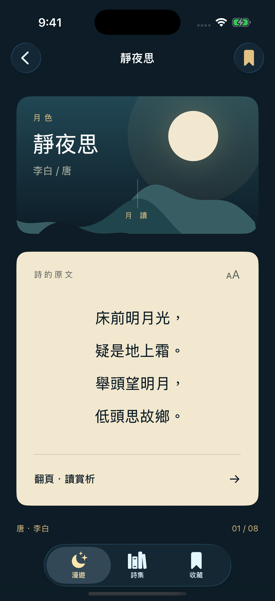
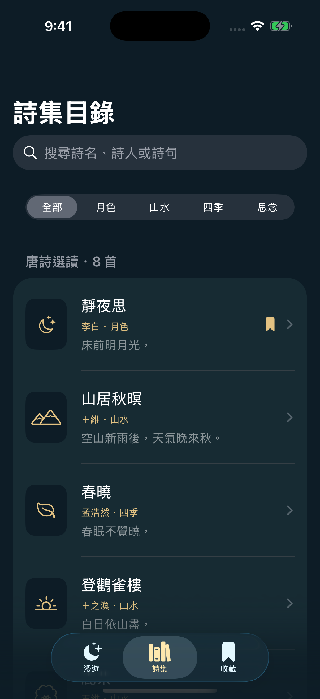

# 用 SwiftUI 做一個動畫電子書 App：月讀・唐詩漫遊

這次的 #88 作業要製作多頁面的電子書 App，結合動畫、導覽、List 與 TabView。我選擇「唐詩選讀」，把八首詩整理成資料，讓使用者可以從首頁進入閱讀、查看賞析，並收藏喜歡的作品。

## Demo

影片檔：Moonlit-iPhone-demo.mp4、Moonlit-iPad-demo.mp4。

【發布前：上傳 YouTube 並把兩支影片網址放在這裡。】影片為 iPhone 與 iPad 模擬器實際畫面的 Debug 自動展示，依序呈現首頁、閱讀、賞析切換、返回與分頁切換；不是實際手指點擊錄影。一般啟動 App 時，仍透過按鈕手動操作。

## 畫面設計

以深青色山水、米白色閱讀卡片與月光金營造安靜的閱讀氣氛。App 分成「漫遊」、「詩集」與「收藏」三個分頁，閱讀頁則依照裝置寬度調整排列方式。


首頁的山水以 SwiftUI Shape 繪製，月光與山巒帶有緩慢動畫。點選「開始閱讀」或下方的精選卡片，就能進入對應的詩作。



閱讀頁上方顯示詩名、作者與主題，下方是原文卡片。點「翻頁・讀賞析」可以切換內容，右上角書籤用來收藏，卡片上的字體按鈕則可放大文字。



目錄列出八首詩，可以依月色、山水、四季、思念篩選，也能搜尋詩名、作者或詩句。


收藏的詩會集中顯示在這裡。資料寫入 UserDefaults，重新開啟 App 後仍會保留；尚未收藏時則顯示操作提示。


iPhone 使用上下排列，iPad 寬版環境則將山水與閱讀卡片分成左右兩欄。版面由 horizontalSizeClass 決定，iPad 窄視窗也能回到上下排列。

## 用 struct 與 array 整理詩作

```swift
struct Poem: Identifiable, Hashable {
    let id: Int
    let title: String
    let author: String
    let theme: String
    let lines: [String]
    let note: String
    let symbol: String
}
```

`Poem` 保存詩名、作者、主題、原文與賞析。八首詩放在 `Poem.library` array，首頁與目錄共用這份資料。`Identifiable` 提供每首詩的識別值，`Hashable` 則讓詩作可以作為 NavigationStack 的導覽資料。

## 用 NavigationStack 切換頁面與傳資料

```swift
NavigationStack {
    List {
        ForEach(Poem.library) { poem in
            NavigationLink(value: poem) {
                Text(poem.title)
            }
        }
    }
    .navigationTitle("詩集目錄")
    .navigationDestination(for: Poem.self) { poem in
        PoemDetailView(poem: poem, store: store)
    }
}
```

這是目錄導覽的簡化片段，`store` 是外層傳入的共用 ReadingStore。點選某首詩時，NavigationLink 將該筆 `Poem` 傳給下一頁，閱讀頁透過 `let poem: Poem` 接收，並使用 `navigationTitle(poem.title)` 在 navigation bar 顯示詩名。

## List 搭配 Identifiable 資料

```swift
ForEach(poems) { poem in
    NavigationLink(value: poem) {
        Text(poem.title)
    }
}
```

實際目錄將這段 ForEach 放在 List 的 Section 裡。`poems` 是經過搜尋、主題或收藏條件篩選後的 array。因為 Poem 遵從 Identifiable，SwiftUI 能辨識每一列，不必另外使用陣列索引當作識別值。

## 用 TabView 與 Tab 製作分頁

```swift
@State private var store = ReadingStore()
@State private var selectedTab = 0

TabView(selection: $selectedTab) {
    Tab("漫遊", systemImage: "moon.stars", value: 0) {
        DiscoverView(store: store)
    }
    Tab("詩集", systemImage: "books.vertical", value: 1) {
        LibraryView(favoritesOnly: false, store: store)
    }
    Tab("收藏", systemImage: "bookmark", value: 2) {
        LibraryView(favoritesOnly: true, store: store)
    }
}
```

`selectedTab` 記錄目前選取的分頁，`store` 則保存所有頁面共用的收藏資料。三個分頁都接收同一份 ReadingStore，因此在閱讀頁收藏後，目錄與收藏分頁也能顯示更新結果。這裡使用的 Tab 語法需要 iOS 18 以上。

## 用狀態變化帶出動畫

```swift
@State private var showNotes = false

private func flipPage() {
    withAnimation(
        reduceMotion
            ? .linear(duration: 0.1)
            : .spring(response: 0.55, dampingFraction: 0.85)
    ) {
        showNotes.toggle()
    }
}
```

`showNotes` 決定卡片顯示原文或賞析。切換時搭配 transition 的位移與透明度，以及 rotation3DEffect 的輕微傾斜，形成翻頁過場；這是內容切換動畫，並非真實紙張捲曲。

詩句進場也會依序淡入並向上移動，月光與山巒使用重複動畫，收藏圖示則使用 symbolEffect。`reduceMotion` 讀取系統「減少動態效果」設定，啟用時停止山水動畫並簡化閱讀過場。

## 檔案拆分與作業需求

`ContentView.swift` 管理分頁與共用資料；`Poem.swift` 定義詩作模型、array 與收藏儲存；`DiscoverView.swift`、`LibraryView.swift`、`PoemDetailView.swift` 分別負責首頁、目錄與閱讀頁；`MoonLandscape.swift` 專門繪製山水與動畫。

這樣的拆分對應題目的多檔案頁面要求，也包含 NavigationStack、NavigationLink 傳資料、navigation bar 標題、自訂 Identifiable struct、array、List，以及 TabView 與 Tab。iPhone 與 iPad 的畫面和影片都放在專案的 Submission 資料夾。

## 測試與限制

專案已在 iPhone 17 與 iPad Pro 11 吋模擬器（iOS 26.5）執行，並檢查首頁、原文、賞析、目錄與收藏畫面。模型驗證包含八首詩的內容完整性、ID 唯一性、收藏切換、重新讀取儲存與取消收藏。

目前提供八首固定詩作，沒有下載書籍、雲端同步或朗讀功能。收藏只保存在本機，刪除 App 會清除資料。畫面採固定深色主題。古典詩作為公版文字，賞析為本專案撰寫；山水與 App Icon 由程式繪製，沒有使用第三方圖片。

## 心得草稿

【發布前請依自己的實際學習經驗修改。】

這次練習讓我理解，電子書 App 不只是把文字放到畫面上，還需要整理每首詩的資料、設計頁面之間的導覽，以及讓不同分頁共用收藏狀態。我將詩作放在 Poem，再把首頁、目錄與閱讀頁拆開，讓每個檔案的工作比較清楚。

另外，動畫需要配合閱讀節奏。詩句逐行出現能引導視線，翻頁過場能提示內容已切換，但動畫太多也可能干擾閱讀，因此加入了「減少動態效果」的處理。比較 iPhone 與 iPad 的版面後，也更能理解同一份資料如何用不同排列方式呈現。未來可以增加更多詩作、閱讀進度或朗讀功能。

## GitHub

[完整程式碼：Heisenbuwga/iosHw5](https://github.com/Heisenbuwga/iosHw5)
